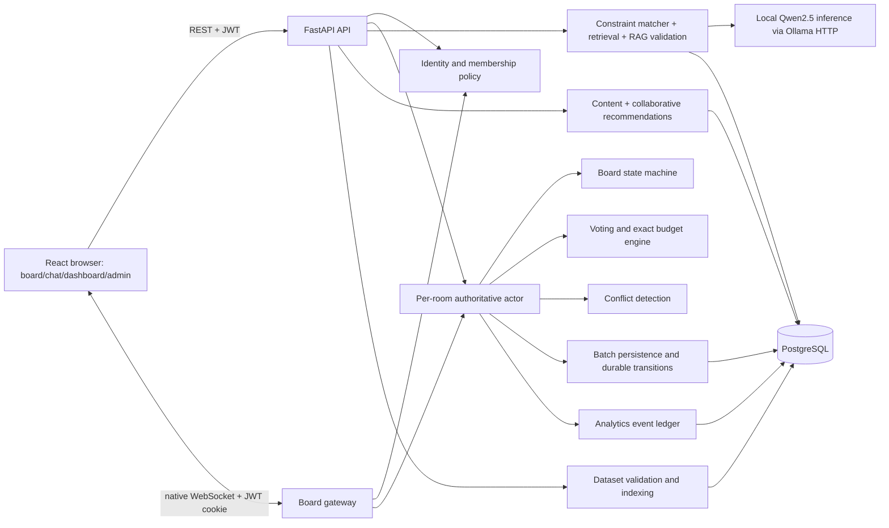

# Architecture

Track A implementation, PRD §§7.1,9.3–9.4,10. Current boundaries and measured limitations are recorded below. [Decisions](DECISIONS.md) distinguishes selected boundaries from provisional policies.

## Components

One FastAPI process with one Uvicorn worker owns API routes and native WebSocket connections. Room actors are keyed by trip ID, so no single-room assumption exists. PostgreSQL is the durable store; disk holds imported files, local assets and private backups. Versioned recommendation artifacts live in PostgreSQL JSONB. A hosted API or local open-source model may supply inference, as permitted by PRD §8.1. The user selected local open-source inference; the current adapter calls Qwen2.5 1.5B through loopback Ollama HTTP. It does not create a second application backend. All matching, retrieval, prompt construction and validation live in Python modules.



## Implemented module boundaries

| Module | Owns | Does not own | Path |
|---|---|---|---|
| API | Pydantic request/response, HTTP errors, dependency injection | Business decisions | `backend/app/api/` |
| Auth/policy | JWT, sessions, membership capability evaluation | Board mutation | `backend/app/auth/` |
| Gateway | Socket auth, input limits, subscriptions, envelopes | Money or lifecycle rules | `backend/app/realtime/` |
| Room | Ordered commands, versions, in-memory aggregate and fan-out | Model calls | `backend/app/realtime/rooms.py` |
| Board | Pure lifecycle transition/position validation | Socket I/O | `backend/app/board/` |
| Budget | Exact splits, ledger and ceiling evaluations | Model arithmetic | `backend/app/budget/` |
| Voting | Eligibility, deadlines, ballot/resolution and winner application | Permission bypass | `backend/app/voting/` |
| Constraints | Price/diet/hours/radius eligibility and score | Natural-language authority | `backend/app/concierge/constraints.py` |
| RAG | Retrieval, citation allowlist, model adapter, validated response | Inventing facts | `backend/app/concierge/` |
| Recommendations | Interaction features, content/CF training and serving | Hard Concierge filtering | `backend/app/recommendations/` |
| Analytics | Event definitions, idempotent projections and reconciliation | Client-reported truth | `backend/app/analytics/` |
| Ingestion | Admin staging, atomic activation, immutable dataset versions | Executing uploaded text | `backend/app/datasets/` |
| Persistence | SQLAlchemy Core transactions and migrations | Alternate room authority | Room/domain services and `backend/alembic/` |

Both HTTP and socket commands invoke the same policy/domain functions. No Redis, message broker or vector database is necessary for one private process.

## Concurrency and state flow

```mermaid
sequenceDiagram
  participant A as Planner A
  participant R as Room actor
  participant D as PostgreSQL
  participant B as Planner B
  A->>R: move item expected positionVersion=4
  R->>R: authorize; compare; apply positionVersion=5
  R-->>A: ack applied, durable=false, roomSeq=31
  R-->>B: board.update version=5
  B->>R: move item expected positionVersion=4
  R-->>B: edit.conflict currentVersion=5 + authoritative item
  R->>D: 100 ms batch, conditional durable-base update + event ledger
  D-->>R: commit
  R-->>A: persistence.committed through roomSeq=31
```

One actor processes commands serially in memory, including while a significant commit is pending. This is not a database row lock. The batch persists accepted commands and their event ledger entries in a transaction, checking each expected durable version. A failed durable version check freezes the room. Recovery reloads the durable aggregate and clients resynchronize under a new epoch. Never overwrite a mismatched durable base. Continuous drag positions remain client previews; send final drop commands, not every pixel.

Each accepted mutation advances `roomSeq`; item mutation advances `positionVersion`, including lifecycle and attendee/cost edits. A new `roomEpoch` on process recovery distinguishes a restored sequence from a previously observed volatile future. Unique `(tripId, commandId)` records enable deduplication of committed commands; volatile commands may disappear in a crash and must not be silently replayed after a new epoch.

## Persistence and recovery

Default batch 100 ms is provisional. Memory acknowledgement is explicitly `applied, durable=false`; it can be lost until the commit watermark. Pin/move/remove use this path. Significant transitions—lock, vote open/cast/resolve, transfer, settings, membership and moderation—flush all earlier room changes in the same transaction before durable acknowledgement and broadcast. Chat/reactions also commit before success. Reads/snapshots include `committedSeq`, so clients can distinguish visible state from durable state. Analytics logs accepted domain events transactionally with persisted state, excluding ephemeral typing/pings.

On DB outage: mark readiness false, freeze mutations for affected rooms, announce persistence degradation, and retain bounded pending data. Read-only memory snapshots identify volatility. On uncertain transaction outcome, query by command ID before retrying. If recovery cannot prove state, reload committed snapshot/event ledger, advance epoch and notify clients of rollback. The nominal crash window is one flush interval plus DB delay, not a guaranteed 100 ms bound. Never acknowledge volatile events as durable.

On startup recover rooms with open votes and resolve overdue rounds before readiness. Other rooms hydrate their committed rows lazily on access. Each new actor epoch distinguishes the restored state. Lifespan shutdown cancels managed maintenance and typing tasks and flushes pending room writes.

## Background work and deployment

The managed 100-ms loop flushes room actors and checks vote deadlines. Conflict detection runs with persisted transitions. Subscribers have bounded queues and slow consumers disconnect for snapshot recovery. Model I/O runs outside the room lock and validates the captured room context before saving an answer. CPU training runs through asyncio.to_thread. One pooled SQLAlchemy engine supplies independent AsyncConnections to concurrent operations.

The documented local setup uses a React/Vite server proxying to one FastAPI worker, PostgreSQL, and local Ollama inference. Built assets are included in the frontend build. Gateway probes check the maintenance task and frozen rooms. Readiness also checks the database migration and startup recovery. Structured logs contain event/room/session/sequence identifiers and safe timestamps. Performance distributions are measured by the harnesses under backend/tests and recorded in PHASE_4_EVIDENCE.md.

## Phase 2 implementation boundaries — 2026-10-31

Implemented code uses `app/realtime/rooms.py` for aggregate ownership, batching/unit-of-work and snapshots; `app/rooms/moderation.py` for durable moderation; `app/board/lifecycle.py` for pure item/vote lifecycle rules; and `app/concierge/{constraints,preferences,rag,service}.py` for authorized rule resolution, retrieval and generation. API transport lives in `app/api/concierge.py` and the native gateway; both invoke the same domain services.

One pooled SQLAlchemy async engine supplies a separate connection/transaction to each concurrent operation. The current implementation uses SQLAlchemy Core AsyncConnection rather than sharing ORM AsyncSessions. Two bounded model calls per worker are permitted; when occupied, another eligible request uses a labeled grounded fallback. Model I/O runs outside the room lock. Context is captured under the room lock and revalidated before a durable answer is saved. In-flight identical questions share a ref-counted per-room lock; completed locks are removed. No user token, model free text or question is emitted to operational logs.

JSON logs whitelist event, trip/session IDs, roomEpoch, roomSeq, committedSeq, correlationId and UTC timestamp. Failed/uncertain commits freeze the room. Crash recovery reloads committed relational state and changes roomEpoch. The test-only recovery factory/file gate is not part of the production entry point. See [Phase 2 evidence](PHASE_2_EVIDENCE.md) for real process-kill, PostgreSQL-outage and lost-ack tests. Backup restore, overdue elections and performance distributions were subsequently exercised in Phase 4.

### Indian locale implementation

New UI trips default to Bengaluru/INR/Asia-Kolkata and can select another active destination. The selected dataset supplies currency and timezone. The display/input helper converts IST to offset-aware UTC instants and retains the destination-local dayIndex, including midnight crossing to the previous UTC day. Server validation continues to use IANA Asia/Kolkata. Actor budget events derive currency from the loaded trip; Concierge eligible choices carry the authorized trip currency to factual rendering. The schema accepts INR and legacy EUR, with trip creation requiring a matching dataset currency. No migration rewrites existing monetary values.

## Phase 3 boundaries (2026-11-01)

`app/budget/{engine,service}.py` owns pure exact splits and versioned split edits. `app/concierge/conflicts.py` owns pure fingerprints; `app/voting/service.py` persists elections/ballots/conflict transitions within the room transaction. `app/analytics/service.py` finalizes sessions. `app/recommendations/{engine,service,evaluate}.py` supplies content/CF training, serving and frozen evaluation. `app/api/phase3.py` is the HTTP adapter for these services plus dashboard/Admin operations. React components live under dashboard/votes/admin.

The managed 100-ms maintenance loop flushes rooms, checks deadlines and detects identical-slot contests. Significant services commit before advancing memory/publishing; PostgreSQL version predicates remain the unexpected-writer guard. Startup hydrates all open-vote rooms and resolves overdue rounds before readiness. If startup recovery fails, liveness stays available and readiness stays false until a successful restart. One worker remains mandatory. Conflict notifications use `trip.board.conflict` after commit and carry the committed state boundary; they do not allocate another room sequence.

Small versioned model artifacts live as checksummed JSONB in PostgreSQL, rather than a disk path. Training runs through `asyncio.to_thread`; promotion retires the previous active artifact and inserts the validated replacement atomically. Serving reads the active version on each request, so no redeploy/reload timer is needed. Fresh per-member history is reranked immediately and normalized scores are averaged for the current group.

## Phase 4 hardening and evidence boundaries

`app/transport.py` bounds HTTP input before parsing. Binary socket frames close explicitly; bounded subscriber queues disconnect slow readers without blocking healthy peers. No new application worker, backend service or schema migration is introduced. The model adapter now generates only one allowlisted source ID; complete filters and factual rendering stay in Python. See AI_TRAVEL_CONCIERGE.md for the internal prompt reduction and unchanged public contract.

Actual restore checks compare every public table's logical digest before application hydration, then verify new epochs and idempotent overdue-election recovery. Generated schema/index metadata and OpenAPI are in `evidence/contracts/`. The reference diagrams above explain the domain; these extracted contracts and the current Alembic head are authoritative for the implemented physical fields. Load/client/model/browser measurements and scope limits are in PHASE_4_EVIDENCE.md.

## Personal activities and destination choice

The authenticated catalog lists active destinations. Creation pins the selected dataset and copies its currency/timezone. The room shortcut opens separate trip creation. Personal activity input shares the pin command and room actor, carries a user-entered name/cost, and uses the same time validation, permissions, versions, persistence, budget splits and overlap detection. A nullable venue reference distinguishes it from catalog data. Venue elections and Concierge location anchors accept catalog entries. See ADR-022 and the current schema.
