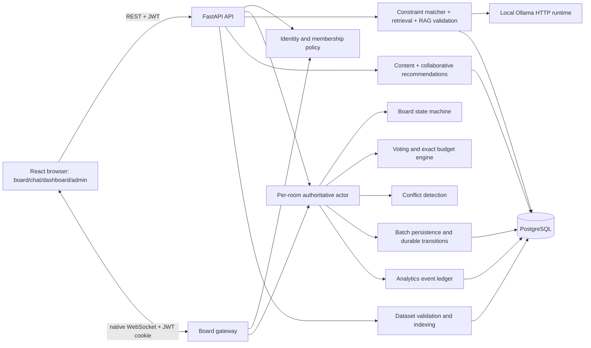

# Architecture

Track A design and partial implementation; PRD §§7.1,9.3–9.4,10. The implemented first-slice boundaries and limitations are noted below. [Decisions](DECISIONS.md) distinguishes selected boundaries from provisional policies.

## Components

One FastAPI process with one Uvicorn worker owns API routes and native WebSocket connections. Room actors are keyed by trip ID, so no single-room assumption exists. PostgreSQL is the durable store; disk holds imported files, local assets, backups and versioned recommendation artifacts. Ollama is an external local inference runtime, called over HTTP by the application; it is not an implemented Concierge service or a second application backend. All matching, retrieval, prompt construction and validation live in Python modules.



## Module boundaries and planned files

| Module | Owns | Does not own | Proposed path |
|---|---|---|---|
| API | Pydantic request/response, HTTP errors, dependency injection | Business decisions | `backend/app/api/` |
| Auth/policy | JWT, sessions, membership capability evaluation | Board mutation | `backend/app/auth/` |
| Gateway | Socket auth, input limits, subscriptions, envelopes | Money or lifecycle rules | `backend/app/realtime/` |
| Room | Ordered commands, versions, in-memory aggregate and fan-out | Model calls | `backend/app/rooms/` |
| Board | Pure lifecycle transition/position validation | Socket I/O | `backend/app/board/` |
| Budget | Exact splits, ledger and ceiling evaluations | Model arithmetic | `backend/app/budget/` |
| Voting | Eligibility, deadlines, ballot/resolution and winner application | Permission bypass | `backend/app/voting/` |
| Constraints | Price/diet/hours/radius eligibility and score | Natural-language authority | `backend/app/concierge/constraints.py` |
| RAG | Retrieval, citation allowlist, model adapter, validated response | Inventing facts | `backend/app/concierge/` |
| Recommendations | Interaction features, content/CF training and serving | Hard Concierge filtering | `backend/app/recommendations/` |
| Analytics | Event definitions, idempotent projections and reconciliation | Client-reported truth | `backend/app/analytics/` |
| Ingestion | Admin staging, atomic activation, immutable dataset versions | Executing uploaded text | `backend/app/datasets/` |
| Persistence | SQLAlchemy repositories, migrations, unit of work | Alternate room authority | `backend/app/persistence/` |

These paths are plans, not files claimed as implemented. Both HTTP and socket commands invoke the same policy/domain functions. No Redis, message broker or vector database is necessary for one private process.

## Concurrency and state flow

```mermaid
sequenceDiagram
  participant A as Planner A
  participant R as Room actor
  participant D as PostgreSQL
  participant B as Planner B
  A->>R: move item expected positionVersion=4
  R->>R: authorize; compare; apply positionVersion=5
  R-->>A: ack applied, durable=false, roomSeq=31
  R-->>B: board.update version=5
  B->>R: move item expected positionVersion=4
  R-->>B: edit.conflict currentVersion=5 + authoritative item
  R->>D: 100 ms batch, conditional durable-base update + event ledger
  D-->>R: commit
  R-->>A: persistence.committed through roomSeq=31
```

One actor processes commands serially in memory, including while a significant commit is pending. This is not a database row lock. A batch can coalesce item v4→v7 into a conditional update from durable v4 to v7 while retaining accepted command ledger entries. A failed CAS indicates unexpected writer or state corruption: freeze that room, reload durable aggregate and force resync. Never overwrite a mismatched durable base. Continuous drag positions remain client previews; send final drop commands, not every pixel.

Each accepted mutation advances `roomSeq`; item mutation advances `positionVersion`, including lifecycle and attendee/cost edits. A new `roomEpoch` on process recovery distinguishes a restored sequence from a previously observed volatile future. Unique `(tripId, commandId)` records enable deduplication of committed commands; volatile commands may disappear in a crash and must not be silently replayed after a new epoch.

## Persistence and recovery

Default batch 100 ms is provisional. Memory acknowledgement is explicitly `applied, durable=false`; it can be lost until the commit watermark. Pin/move/remove use this path. Significant transitions—lock, vote open/cast/resolve, transfer, settings, membership and moderation—flush all earlier room changes in the same transaction before durable acknowledgement and broadcast. Chat/reactions also commit before success. Reads/snapshots include `committedSeq`, so clients can distinguish visible state from durable state. Analytics logs accepted domain events transactionally with persisted state, excluding ephemeral typing/pings.

On DB outage: mark readiness false, freeze mutations for affected rooms, announce persistence degradation, and retain bounded pending data. Read-only memory snapshots identify volatility. On uncertain transaction outcome, query by command ID before retrying. If recovery cannot prove state, reload committed snapshot/event ledger, advance epoch and notify clients of rollback. The nominal crash window is one flush interval plus DB delay, not a guaranteed 100 ms bound. Never acknowledge volatile events as durable.

On startup hydrate snapshots/rows and persisted active votes before readiness; resolve expired votes once by unique resolution key. Store deadline in UTC; a restart cannot extend the election. Reconstruct chat and aggregates from durable records. On clean shutdown stop accepting writes, drain/flush, close sockets with reconnect advice; enforce timeout and log uncommitted watermark. See [operations](DEPLOYMENT_AND_OPERATIONS.md).

## Background work and deployment

Managed lifespan tasks own flush scheduling, vote deadlines, presence expiry and conflict evaluation. Avoid untracked request background tasks for critical recovery work. Overlap/budget checks run after each accepted change; bounded per-room queue plus version checks discard obsolete results. Small pure checks run inline; costly model I/O uses an async HTTP client; CPU-bound training/index rebuild uses an executor and atomic artifact swap. Never share an AsyncSession across concurrent tasks.

One private host serves bundled React assets, API and gateway; PostgreSQL and Ollama bind loopback/private network. Use TLS/WSS when testing across machines. Gateway health measures actor loop freshness and queue status; readiness additionally checks DB/schema. Metrics: command queue depth, rejected stale versions, mutation latency, flush lag, socket lag/disconnects, model latency/fallback and constraint violations. Correlation IDs appear in safe structured logs. Capacity is configurable up to the 50-planner design target; actual performance remains unmeasured (§§10.2,14.1).

## Implementation status — 2026-10-30

The first slice uses a single pooled async engine, room actors, native WebSockets and basic liveness, schema readiness and gateway probes. Later architecture on this page remains planned. See [evidence](PHASE_1_EVIDENCE.md).

The first-slice room actor is wired to membership authorization, batched persistence and WebSocket snapshots; later lifecycle and recovery drills remain pending. See [evidence](PHASE_1_EVIDENCE.md).

The first pin/snapshot actor now maintains in-memory authoritative items and batches pending pins to PostgreSQL, with volatile applied acknowledgements, committed watermark, freeze on batch failure and a new epoch on reload. Membership joining and Leader invite changes persist pending pins and the significant change in the same transaction under the room actor lock; full recovery drills and later-feature snapshot state remain outstanding. See [evidence](PHASE_1_EVIDENCE.md).
