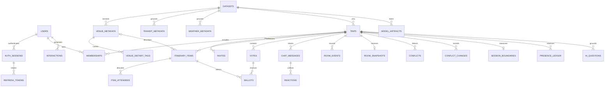

# Implemented database schema

Current Alembic head is `0012_personal_activities`. This describes the PostgreSQL implementation for PRD §§7.2 and 9.3–9.4. Migrations define constraints and foreign keys. [Extracted schema and indexes](../evidence/contracts/schema.json) records the database exercised by the restore test. UUIDs travel as strings, timestamps use UTC instants, and money uses integer minor units in the trip currency.

## Physical tables

Each entry lists the actual column name and PostgreSQL type. A question mark marks a nullable column.

| Table | Columns |
|---|---|
| `ai_questions` | `id` uuid, `trip_id` uuid, `user_id` uuid, `request_key` uuid, `command_hash` character varying, `response` jsonb, `created_at` timestamp with time zone |
| `auth_sessions` | `id` uuid, `user_id` uuid, `refresh_hash` character varying, `family_id` uuid, `expires_at` timestamp with time zone, `revoked_at` timestamp with time zone? |
| `ballots` | `vote_id` uuid, `user_id` uuid, `choice_item_id` uuid, `version` bigint, `cast_at` timestamp with time zone |
| `chat_messages` | `id` uuid, `trip_id` uuid, `user_id` uuid, `body` text, `created_at` timestamp with time zone, `room_seq` bigint |
| `conflict_changes` | `trip_id` uuid, `room_seq` bigint, `fingerprint` text, `status` text |
| `conflicts` | `trip_id` uuid, `fingerprint` text, `status` text, `data` jsonb, `opened_seq` bigint, `resolved_seq` bigint? |
| `datasets` | `id` uuid, `destination` character varying, `version` integer, `timezone` character varying, `currency` character varying, `status` character varying, `provenance` jsonb, `checksum` character varying, `created_at` timestamp with time zone |
| `http_idempotency` | `user_id` uuid, `key` uuid, `route` character varying, `body_hash` character varying, `response` jsonb, `created_at` timestamp with time zone |
| `interactions` | `id` uuid, `user_id` uuid, `trip_id` uuid, `venue_id` uuid, `dataset_id` uuid, `kind` text, `event_id` uuid, `created_at` timestamp with time zone |
| `invites` | `id` uuid, `trip_id` uuid, `code_hash` character varying, `assigned_role` character varying, `expires_at` timestamp with time zone, `max_uses` integer, `uses` integer, `revoked_at` timestamp with time zone? |
| `item_attendees` | `item_id` uuid, `user_id` uuid, `weight` integer |
| `itinerary_items` | `id` uuid, `trip_id` uuid, `venue_id` uuid?, `dataset_id` uuid, `day_index` integer, `starts_at` timestamp with time zone, `ends_at` timestamp with time zone, `lifecycle_stage` character varying, `pinned_by_user_id` uuid, `position_version` bigint, `removed_at` timestamp with time zone?, `price_snapshot_minor` bigint, `split_mode` character varying, `personal_name` character varying? |
| `memberships` | `trip_id` uuid, `user_id` uuid, `role` character varying, `status` character varying, `can_pin` boolean, `muted` boolean, `joined_at` timestamp with time zone, `constraints` jsonb |
| `model_artifacts` | `id` uuid, `dataset_id` uuid, `artifact` jsonb, `checksum` text, `trained_through` timestamp with time zone, `active` boolean, `created_at` timestamp with time zone |
| `presence_ledger` | `id` uuid, `trip_id` uuid, `session_id` uuid, `connected_planners` integer, `occurred_at` timestamp with time zone |
| `reactions` | `message_id` uuid, `user_id` uuid, `emoji` character varying |
| `refresh_tokens` | `token_hash` character varying, `session_id` uuid, `used_at` timestamp with time zone?, `expires_at` timestamp with time zone |
| `room_events` | `trip_id` uuid, `room_seq` bigint, `event_id` uuid, `command_id` uuid?, `session_id` uuid, `actor_id` uuid?, `type` character varying, `payload` jsonb, `occurred_at` timestamp with time zone, `legacy_auth_session_id` uuid? |
| `room_snapshots` | `trip_id` uuid, `committed_seq` bigint, `schema_version` integer, `state` jsonb, `updated_at` timestamp with time zone |
| `session_boundaries` | `trip_id` uuid, `session_id` uuid, `started_at` timestamp with time zone, `ended_at` timestamp with time zone? |
| `transit_metadata` | `id` uuid, `dataset_id` uuid, `source_id` character varying, `data` jsonb |
| `trips` | `id` uuid, `leader_user_id` uuid, `dataset_id` uuid, `destination` character varying, `timezone` character varying, `start_date` date, `end_date` date, `currency` character varying, `total_budget_minor` bigint, `status` character varying, `room_locked` boolean, `max_participants` integer, `room_seq` bigint, `committed_seq` bigint, `room_epoch` uuid, `state_version` bigint, `created_at` timestamp with time zone, `planning_session_id` uuid, `category_ceilings` jsonb |
| `users` | `id` uuid, `normalized_email` character varying, `password_hash` text, `display_name` character varying, `is_admin` boolean, `preferences` jsonb, `created_at` timestamp with time zone |
| `venue_dietary_tags` | `venue_id` uuid, `dataset_id` uuid, `tag` character varying |
| `venue_metadata` | `id` uuid, `dataset_id` uuid, `source_id` character varying, `name` character varying, `category` character varying, `price_per_person_minor` bigint, `currency` character varying, `latitude` numeric, `longitude` numeric, `rating` numeric?, `description` text, `hours` jsonb, `search_vector` tsvector? |
| `votes` | `id` uuid, `trip_id` uuid, `slot_key` text, `status` text, `closes_at` timestamp with time zone, `data` jsonb, `created_at` timestamp with time zone |
| `weather_metadata` | `id` uuid, `dataset_id` uuid, `source_id` character varying, `local_date` date, `data` jsonb |

## Relationships

The diagram shows principal foreign-key relationships. Dataset and venue references use composite keys where a venue must belong to a pinned version.

Vote options, eligibility and results live in `votes.data` JSONB. Transit/weather authored metadata and model artifacts also use JSONB. Member constraints live in `memberships.constraints`. The schema reserves `room_snapshots`, while actor recovery hydrates committed relational rows and votes.

## Source and money invariants

Catalog itinerary entries reference `venue_id,dataset_id`. Personal activities have a null venue ID and a bounded `personal_name`. The source check requires exactly one of venue ID and personal name. Their dataset ID remains the room's pinned version. The per-person snapshot allows zero for free activities. Dataset venue validation requires positive prices. Personal activities participate in budgets and overlaps and are excluded from venue interactions, recommendations and location anchors.

Attendees and nonnegative integer weights are stored per item. The application checks active trip membership and a positive weight sum. Exact allocations and remainder order are computed by the budget engine. INR uses paise and legacy EUR uses cents. Existing values retain their currency.

## Indexes and transactional rules

The extracted schema lists every actual index definition. Key indexes include unique destination/version and active destination selection, unique active Leader per trip, unique open vote per slot, unique active model artifact per dataset, venue full-text GIN, event session/time, chat room sequence, and interaction user/time and venue/time.

Board writes use conditional `position_version` predicates and expected committed room sequence. A failed durable-base check freezes mutations for that room. Batched pin/move/remove writes and significant durable transitions follow the [architecture](ARCHITECTURE.md). Significant transitions flush prior pending changes within the same transaction.

Migration 0012 upgrades existing catalog rows with nullable personal names. A downgrade requires removal of personal activities and zero-cost rows before the older constraints can be restored. Back up the database before operational schema changes.

## Verification and design history

The disposable verification applies every migration and imports Lisbon, Bengaluru and Goa. The restore test compares logical table digests before actor hydration and then exercises recovery. Historical phase evidence records the schema available at each checkpoint. The current migrations and extracted schema define the submission.

The PRD also discusses a document-database model as a learning exercise. This application implements PostgreSQL. A conceptual document mapping would embed bounded hours/preferences while retaining separate collections for unbounded messages/events and version-checked item edits.
