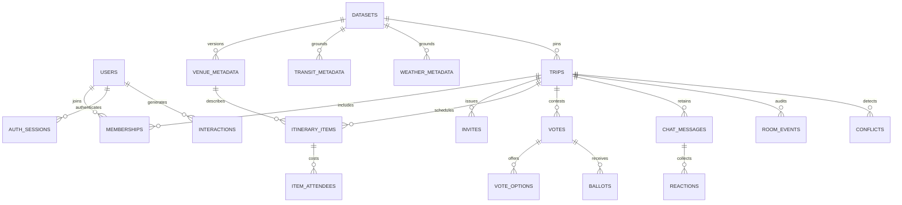

# Database schema

Proposed PostgreSQL schema, PRD §§7.2,9.3–9.4. No migrations applied. Names are snake_case in SQL and camelCase over HTTP/socket. IDs are UUIDs serialized as strings; illustrative prefixed IDs in examples are aliases, not the production ID validator. All timestamps `timestamptz`; money `bigint` minor units; versions/sequences `bigint CHECK >=0`. FKs are required unless marked nullable. JSONB fields have Pydantic validation and bounded sizes.

## Entities

| Table | Fields and constraints |
|---|---|
| users | id PK, normalized_email text UNIQUE, password_hash text, display_name varchar(80), is_admin bool default false, preferences jsonb (dietaryTags/category ceilings/categories), created_at |
| auth_sessions | id PK, user_id FK, refresh_hash UNIQUE, family_id UUID, expires_at, revoked_at nullable; never raw refresh token |
| datasets | id PK, destination text, version int, timezone text, status staging/active/retired, provenance jsonb, checksum text, created_by FK users, created_at; UNIQUE(destination,version), one active version/destination |
| venue_metadata | id UUID, dataset_id FK, source_id text, name text, category enum, price_per_person_minor bigint CHECK >0, currency char(3), latitude numeric CHECK [-90,90], longitude numeric CHECK [-180,180], rating numeric CHECK [0,5], description text, hours jsonb, search_vector tsvector; PK(id,dataset_id), UNIQUE(dataset_id,source_id) |
| venue_dietary_tags | venue_id + dataset_id composite FK, tag text from vocabulary; composite PK(venue_id,dataset_id,tag) |
| transit_metadata | id PK, dataset_id FK, from_source_id/to_source_id text referencing imported venues, mode text, duration_minutes int CHECK >0, valid_from/to timestamptz, synthetic bool, provenance jsonb |
| weather_metadata | id PK, dataset_id FK, local_date date, summary text, temperature_c numeric, synthetic bool, provenance jsonb; UNIQUE(dataset_id,local_date) |
| trips | id PK, leader_user_id FK users, dataset_id FK, destination text, timezone text, start_date/end_date date CHECK end>=start, currency, total_budget_minor CHECK >0, category_ceilings jsonb, status drafting/live/finalized, room_locked bool, settings jsonb (maxParticipants 2..50, bufferMinutes, radiusKm, voteSeconds), room_seq, committed_seq, room_epoch UUID, state_version bigint, created_at |
| memberships | trip_id FK, user_id FK, role viewer/planner/leader, status active/left/removed, can_pin bool, muted bool, dietary_tags text[], category_ceilings jsonb, total_ceiling_minor nullable, joined_at; PK(trip_id,user_id) |
| invites | id PK, trip_id FK, code_hash UNIQUE, assigned_role viewer/planner, expires_at, max_uses int, uses int, revoked_at nullable; redeem under room actor |
| itinerary_items | id PK, trip_id FK, venue_id/dataset_id composite FK, day_index int CHECK >=0, starts_at/ends_at CHECK end>start, lifecycle_stage drafting/voting/locked, pinned_by_user_id FK, position_version, removed_at nullable, price_snapshot_minor CHECK >0, split_mode even/weighted |
| item_attendees | item_id FK, user_id FK users, weight int CHECK >=0; PK(item_id,user_id); application verifies trip membership and positive sum |
| votes | id PK, trip_id FK, slot jsonb, item_id FK (stable slot representative), status open/resolved/cancelled, closes_at, eligible_user_ids UUID[], winning_venue_id nullable, resolution_reason text nullable, created_at; at most one open vote per slot key |
| vote_options | vote_id FK, item_id FK, venue_id/dataset_id composite FK, order_key text; PK(vote_id,item_id) |
| ballots | vote_id FK, user_id FK, choice_item_id FK, cast_at, version bigint; PK(vote_id,user_id); option must belong to vote |
| chat_messages | id PK, trip_id FK, user_id FK nullable for system/AI, msg_type chat/ai_answer/system/conflict, body text, created_at, room_seq |
| reactions | message_id FK, user_id FK, emoji varchar(16); PK(message_id,user_id,emoji) |
| interactions | id PK, user_id FK, trip_id FK, venue_id nullable, destination/category text, kind view/pin/like/lock/co_travel, liked bool nullable, created_at, event_id UNIQUE; training derives co-travel from membership history |
| room_events | trip_id FK, room_seq bigint, event_id UUID UNIQUE, command_id UUID nullable, session_id UUID, actor_id nullable, type text, payload jsonb, occurred_at; PK(trip_id,room_seq), UNIQUE(trip_id,command_id) when command_id nonnull |
| room_snapshots | trip_id PK/FK, committed_seq, schema_version int, state jsonb, updated_at; rebuild accelerant, not independent authority |
| conflicts | id PK, trip_id FK, fingerprint text, type overlap/budgetBreach, item_ids UUID[], status open/resolved, details jsonb, opened_seq, resolved_seq nullable; one open fingerprint/trip |
| model_artifacts | id PK, kind content_cf, trained_through timestamptz, dataset_hash text, relative_path text, metrics jsonb, active bool, created_at |

`room_events` with type session.started/session.ended tracks planning sessions. Every persisted event carries stable session ID; chat and analytics can span reconnects. Budgets are derived from items/attendees at a committed sequence; an optional cached projection must carry that sequence. Room settings and role transfer transactions assert exactly one Leader and consistency with `trips.leader_user_id`. A partial unique membership index on trip where active role=leader prevents duplicate leaders; application transaction guarantees at least one. Finalization requires no open votes/conflicts (provisional).

## ER view

## Indexes and update mechanics

Indexes: items `(trip_id,day_index,starts_at)` and `(trip_id,position_version)`; chat `(trip_id,created_at,id)`; events `(trip_id,room_seq)` and `(session_id,occurred_at)`; memberships `(user_id,status)`; votes partial `(closes_at) WHERE status='open'`; interactions `(user_id,created_at)` and `(venue_id,created_at)`; venues `(dataset_id,latitude,longitude)` for bounding box plus exact Haversine application check; GIN on search_vector and dietary tags if needed. A compound lat/lng index alone is not a spherical distance calculation. One small destination needs no PostGIS extension.

Batch update condition: `WHERE id=:id AND position_version=:durableBaseVersion`; set final position/version and require affected row count=1. Coalesced updates retain all accepted event log entries. Significant transitions and earlier pending changes share one transaction, followed by committed watermark advancement. No explicit row-lock statements serialize moves. See [architecture](ARCHITECTURE.md) for unexpected-writer failure behavior.

## Migration sequence

Reference-model adaptation: PRD §7.2's `item_votes` becomes `votes` + `vote_options` + `ballots` so one contested slot can hold several candidate items, one ballot per eligible user and a durable deadline/result. PRD `users.role` becomes account `is_admin` plus trip membership role (ADR-003). `participantIds` is represented by memberships rather than duplicated mutable arrays. No reference entity is dropped: users, trips, itinerary items, venue metadata, chat and interactions remain explicit.

M001 users/sessions; M002 datasets/venues/tags/transit/weather; M003 trips/memberships/invites/items/attendees; M004 room events/snapshots/chat/reactions; M005 votes/ballots/conflicts; M006 interactions/artifacts and analytics indexes. Alembic revisions are planned. Seed a local Admin through an explicit CLI, never registration-body role. Use expand/backfill/contract for changed fields; backup before destructive migration and restore backup if downgrade would lose data. Dataset activation is atomic and cannot rewrite versions used by existing trips.

## Relational/document comparison (PRD §3 learning outcome)

PostgreSQL uses explicit join tables for membership, dietary tags, attendees and ballots; FK/unique/check constraints support budget/vote correctness. MongoDB alternative would use users/trips/items/venue_metadata/chat_messages/interactions collections, embed bounded preferences/hours, keep unbounded chats/events separate, and use unique membership/ballot indexes plus transactions for cross-document vote resolution. Both use version predicates. A trip document containing all chat/items risks unbounded growth and hot-document contention. Only PostgreSQL is selected and implemented later; the alternative mapping is conceptual, not a second required application.
